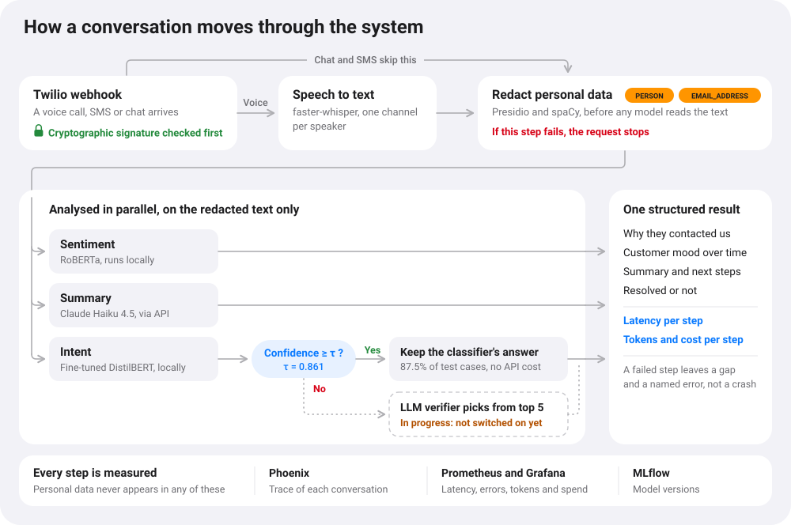

# Conversation Intelligence Engine

Turns customer calls and chats into answers a business can act on: why people got in touch, how they felt, and whether the problem was solved. Personal data is removed before any model reads the conversation, and every result states exactly how long it took and what it cost.

<p align="center">
  
</p>

## What it does

Imagine a bank whose customers call and message all day. Nobody can read everything, and the transcripts are full of names, emails and card numbers that should not be sent to a third-party AI model.

This service receives each conversation, transcribes it if it is a call, and strikes out the personal data. Small models that run on our own machine work out the customer's mood and their reason for contacting the bank. A language model then writes a summary from the redacted text. Supervisors get structured data they can count and chart, instead of thousands of transcripts.

## See it running

https://github.com/user-attachments/assets/2382a14f-6e00-4035-a199-56961475a518

The recording shows a real request through the API, then its trace in Arize Phoenix, where the language model's input contains `<PERSON>` and `<EMAIL_ADDRESS>` instead of the customer's details, then the Grafana dashboard.

## What one conversation costs

From one real request, the one shown in the animation above:

| Step | Runs on | Time | Tokens in / out | Cost |
|---|---|---:|---:|---:|
| Redact personal data | Presidio + spaCy, local | included in total | none | none |
| Sentiment | RoBERTa, local | 137 ms | none | none |
| Intent | Fine-tuned DistilBERT, local | 122 ms | none | none |
| Summary | Claude Haiku 4.5, API | 2,236 ms | 1,203 / 173 | $0.002068 |
| **Whole conversation** | | **2,293 ms** | | **$0.002068** |

The three analysis steps add up to more than the total because they run at the same time. The summary is what the customer waits for, and the only step that costs money. At this rate 1,000 conversations would cost about $2.07, a projection from a single run rather than a measured average.

These figures are not worked out afterwards. They travel with every response:

- Each step returns its own latency, model, model version, prompt version, tokens and cost.
- If a model used tokens but has no known price, the response reports the cost as unknown. It never counts as $0.
- Every conversation has a trace in Phoenix. Prometheus and Grafana track latency, errors, tokens and spend over time.

## How it works

<p align="center">
  
</p>

1. **Ingest.** A signed Twilio webhook or a direct API call delivers the conversation. Calls are transcribed with faster-whisper, using the stereo channels to tell customer from agent.
2. **Redact.** Presidio and spaCy replace personal data with labels such as `<PERSON>`. If this step fails, the request stops.
3. **Analyse in parallel.** A LangGraph graph runs sentiment, intent and summary on the redacted text only.
4. **Answer.** The API returns one structured result, with partial results if a non-critical step failed.

The design rule is *small model first, language model only where it adds something*. The intent classifier answers on its own when it is confident, which costs nothing per call. Below a calibrated threshold, a language model will choose among its top five candidates. That last part is still in progress (see Status).

## Engineering decisions

| What must hold | How it is enforced |
|---|---|
| Personal data never reaches a model or a trace | Redaction runs outside the graph, because tracing records each graph node's input. An integration test plants personal data and checks every exported span. |
| A failed redaction cannot leak data | Redaction fails closed, and its error carries no text from the conversation. Other steps degrade to a partial result. |
| A client cannot skip redaction | The API discards any `redacted` flag sent by the caller and always redacts. |
| Forged webhooks are rejected | Twilio signatures are checked before a webhook is processed. |
| A broken model never reaches a customer | All analysis models load before the service reports ready, under a timeout. If one fails, the service does not start. |
| Bugs are not hidden as degraded results | The pipeline catches only expected failures. Anything else propagates and returns an error. |
| Confidence scores mean something | The classifier is calibrated with temperature scaling, and its routing threshold is chosen on validation data. |
| Results can be traced to what produced them | Prompts are versioned and immutable. The intent model is registered in MLflow and the sentiment model is pinned to an exact revision. |

Longer reasoning is in the [architecture notes](docs/ARCHITECTURE.md) and the decision records:
[small model first](docs/adr/0001-small-model-first.md),
[LangGraph](docs/adr/0002-langgraph-orchestration.md),
[Phoenix and OpenTelemetry](docs/adr/0003-tracing-phoenix-otel.md),
[versioned prompts](docs/adr/0004-prompt-versioning.md),
[PyTorch as an opt-in group](docs/adr/0005-pytorch-cu128-dependency-group.md).

## Measured so far

| What | Result | Measured on |
|---|---|---|
| Intent macro-F1 | **0.926** | Banking77 test set, 3,076 utterances, 77 intents |
| Share of utterances the classifier handles alone | **87.5 %**, at 97.7 % accuracy | Same test set, threshold 0.861 |
| Calibration error (ECE) | **0.017** | Same test set |
| Intent latency, 3 customer turns, p95 | **34 ms** CPU, **9 ms** GPU | 500 samples, RTX 5060 Laptop |
| Speech-to-text, processing time / audio length | **0.20** CPU, **0.04** GPU | Warm start, one 10-second clip |
| Test suite | **493** unit tests passing in CI | Plus integration tests with real models |

Intent figures use single utterances from a public dataset, so expect real conversations to be harder. A golden set of synthetic conversations with known labels is being built to measure that.

## Status

**Working today:** chat and SMS through the API, redaction, sentiment, intent, summary, tracing, metrics and dashboards, tested end to end with real models.

**Not finished yet:**

- The language-model verifier for low-confidence intents. The routing exists, but for now it keeps the classifier's answer, so there is no hybrid result to report yet.
- The golden set and evaluation in CI.
- Storing results in Postgres. Today the API returns them and keeps nothing.
- Fetching call recordings from Twilio. Transcription works on audio files, but the recording webhook returns 503.
- Cloud deployment, canary releases and load testing against the SLOs in the [architecture notes](docs/ARCHITECTURE.md).

Known issues are tracked in [GitHub Issues](https://github.com/anderescaray/conversation-intelligence-engine/issues).

## Run it locally

You need Python 3.12, [uv](https://docs.astral.sh/uv/), Docker and an Anthropic API key. A GPU is optional. The intent model is not distributed with the repository, so the first run trains it.

```bash
# 1. Install, and add ANTHROPIC_API_KEY to .env
uv sync --group ml
cp .env.example .env

# 2. Start Phoenix, Prometheus, Grafana, MLflow and Postgres
docker compose -f infra/docker-compose.yml up -d

# 3. Train and register the intent model (about 85 s on an RTX 5060 Laptop)
uv run python -m training.intent.download_data
uv run python -m training.intent.train

# 4. Download the pinned sentiment model
uv run --group ml hf download cardiffnlp/twitter-roberta-base-sentiment-latest config.json merges.txt pytorch_model.bin special_tokens_map.json vocab.json --revision 3216a57f2a0d9c45a2e6c20157c20c49fb4bf9c7

# 5. Start the API
uv run uvicorn convintel.api.main:create_production_app --factory --port 8000
```

Then, from another terminal, send the example conversation:

```bash
curl -s -H 'Content-Type: application/json' \
  --data @examples/duplicate-charge.json \
  http://localhost:8000/v1/conversations
```

Each request costs about $0.002 in API usage. Explore the API at <http://localhost:8000/docs>, traces at <http://localhost:6006> and dashboards at <http://localhost:3000> (`admin` / `admin`).

## How it was built

I worked as the technical lead of a small team of coding agents. Claude Code and Devin wrote most of the implementation on separate branches, against frozen contracts and written task briefs. I wrote parts of the pipeline myself. Cursor reviewed the pull requests independently, and I reviewed and merged every one.

Tests were checked by deliberately breaking the code and confirming that they fail. Large changes were split into stacked pull requests: [#27 to #30](https://github.com/anderescaray/conversation-intelligence-engine/pull/27) for the API and [#36 to #40](https://github.com/anderescaray/conversation-intelligence-engine/pull/36) for the pipeline. [#45](https://github.com/anderescaray/conversation-intelligence-engine/pull/45) is a good example of a complete change, from a warning noticed during a demo to the reviewed fix. The working method is in [WORKFLOW.md](docs/WORKFLOW.md) and the engineering log in [LOG.md](docs/LOG.md).

## License

[MIT](LICENSE)
