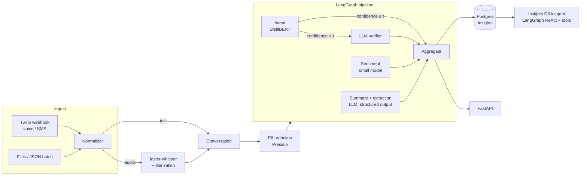

# Architecture

## Goal

Extract meaning from voice and messaging conversations at scale: *what did the customer want,
how did they feel, was it resolved, what happens next*. Do it with production discipline:
measurable quality, bounded latency and cost, and full observability.

## Design principles

1. **Small model first, LLM when it earns its place.** Classical fine-tuned models handle the
   high-volume, well-defined tasks (intent, sentiment) cheaply and fast. LLMs handle open-ended
   tasks (summary, extraction) and act as a **verifier** only when the small model is unsure.
   See ADR-0001.
2. **Agents where there is a decision, plain code where there isn't.** The LangGraph graph
   has real branches (confidence routing, retries, fallbacks). Deterministic steps stay
   as plain functions.
3. **Everything is versioned:** models (MLflow registry), prompts (`prompts/` + MLflow prompt
   registry), pipeline (`pipeline_version` on every result).
4. **Everything is observable:** one trace per conversation covering ASR → PII → operators → LLM
   calls. Metrics measured against explicit SLOs.
5. **PII never leaves the redaction boundary.** Operators and LLMs only see redacted text.

## Data flow

The three operators run **in parallel** (LangGraph fan-out) and join at `Aggregate`.

## Components

| Component | Tech | Why |
|---|---|---|
| Ingest | FastAPI webhook, Twilio SDK | Real Twilio integration (trial account) + offline batch |
| ASR | faster-whisper (CTranslate2), pyannote (optional) | Fast CPU/GPU inference; diarization gives speaker turns |
| PII | Microsoft Presidio | Standard, extensible recognizers |
| Sentiment | HF `cardiffnlp/twitter-roberta-base-sentiment-latest` (or similar) | Cheap, per-turn trajectory |
| Intent | DistilBERT fine-tuned on Banking77 + synthetic data | Showcase of fine-tuning, calibration, registry |
| LLM ops | LangChain chat models + structured output (Pydantic) | Provider-agnostic, typed output |
| Orchestration | LangGraph | State, parallel branches, conditional routing, checkpoints |
| Tracing / LLM evals | Arize Phoenix via OpenTelemetry (OpenInference) | Open source, self-hosted, OTel-native. See ADR-0003 |
| Model + prompt registry | MLflow | Already known; extend to prompts |
| Metrics / SLOs | Prometheus + Grafana | Industry standard |
| Serving | FastAPI + uvicorn, Docker | Async, typed |
| Deploy | GCP Cloud Run (or AWS ECS Fargate), Terraform, GitHub Actions | Real cloud, IaC, canary via traffic split |

## Telemetry

**Traces:** one root span `conversation.process` per conversation, with child spans
`asr.transcribe`, `operator.<name>` (e.g. `operator.pii`), `llm.call`. Attributes: `conversation.id`,
`operator.version`, `prompt.version`, `model.id`, `llm.tokens.*`, `llm.cost_usd`.

**Metrics** (Prometheus, prefix `convintel_`):

| Metric | Type | Labels |
|---|---|---|
| `convintel_requests_total` | counter | `route`, `status` |
| `convintel_pipeline_latency_seconds` | histogram | `channel` |
| `convintel_operator_latency_seconds` | histogram | `operator`, `version` |
| `convintel_llm_tokens_total` | counter | `model`, `direction` (in/out) |
| `convintel_llm_cost_usd_total` | counter | `model`, `operator` |
| `convintel_operator_errors_total` | counter | `operator`, `error_type` |
| `convintel_intent_verifier_invocations_total` | counter | `outcome` (agreed/overrode) |
| `convintel_asr_realtime_factor` | histogram | `model` |

## SLOs (initial targets, revisited after load tests)

| SLO | Target |
|---|---|
| Text conversation, p95 end-to-end latency | < 4 s |
| Voice, processing time / audio duration (RTF) p95 | < 0.5 |
| Pipeline error rate (5xx or operator failure) | < 1 % over 1 h |
| LLM cost per conversation (mean) | < $0.005 |
| Intent macro-F1 on golden set | ≥ 0.90 (CI gate: no drop > 2 pts) |

## Deployment and releases

- Two Cloud Run revisions; canary = 10 % traffic to the new `pipeline_version`.
- Promotion only if the canary meets its SLOs for 30 min **and** the offline eval gate passed in CI.
- Rollback = shift traffic back (one command, documented in `docs/RUNBOOK.md`).
