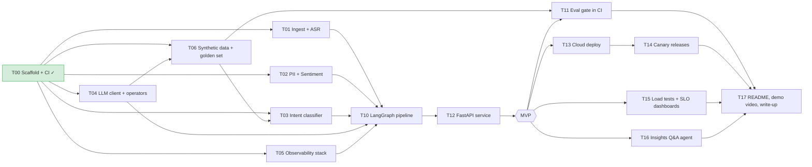

# Build plan

Human = architect + reviewer. Agents = implementers, one task each:

- **Claude Code** (Pro plan) and **Pi** (Anthropic API key, inside the devcontainer) run locally,
  each in its own git worktree.
- **Devin** runs in its own cloud environment and opens PRs directly against the repo.
- **Cursor** is the interactive editor for review and small human-driven fixes; it owns no lane.

Each task has a brief in `docs/tasks/` that doubles as the agent's prompt, and a GitHub issue
labelled `agent-task` plus its wave.

## Dependency graph

## Phase 0 — Foundations (sequential, days 1–2) ✅

| ID | Task | Who | Status |
|---|---|---|---|
| T00 | Scaffold: `uv` project, ruff, pyright, pytest, pre-commit, GitHub Actions CI, `.env.example`, `convintel.config`, `convintel.errors` | You + 1 agent (pair) | ✅ Done |
| — | Review and freeze `src/convintel/contracts/` | **You** | ✅ Done |
| — | Create GitHub issues from `docs/tasks/` | You | ✅ Done |

Exit criteria: CI green on an empty test suite, contracts merged, all Phase 1 issues open.

## Phase 1 — Parallel lanes (days 3–7)

| ID | Lane | Task | Agent | Wave | Depends on |
|---|---|---|---|---|---|
| T05 | E | docker-compose: Phoenix, Prometheus, Grafana, MLflow, Postgres + `convintel.telemetry` | Devin | 1 | T00 |
| T04 | D | LLM client wrapper + summary/extraction operator + prompt versioning | Claude Code | 1 | T00 |
| T02 | B | PII redaction (Presidio) + sentiment operator | Claude Code | 1 | T00 |
| T06 | F | Synthetic conversation generator + TTS audio + labelled golden set | Devin | 2 | T00, **T04** |
| T03 | C | Intent classifier: fine-tune, calibrate, MLflow registry | **Bake-off: Pi vs Claude Code** | 2 | T00 (+T06 for synthetic data, optional) |
| T01 | A | Ingest (Twilio webhook, files) + faster-whisper transcription | Claude Code | 2 | T00 |

### Waves

- **Wave 1:** T05 (Devin), T04 (Claude Code), T02 (Claude Code).
- **Wave 2:** T06 (Devin), T03 (bake-off Pi vs Claude Code), T01 (Claude Code).
  Starts once T04 is merged: T06 must call LLMs through `convintel.llm.client`.

Three concurrent lanes per wave keeps review manageable. Two of them run on Claude Code under a
Pro plan, so watch usage limits and stagger the launches if needed.
**Throughput is limited by your review, not by the agents.**

**Merge order:** T05 → T04 → T02 → T06 → T03 → T01 (infra and shared utilities first).
Rebase each remaining worktree after every merge.

## Phase 2 — Integration (sequential, days 8–10)

| ID | Task | Who |
|---|---|---|
| T10 | LangGraph pipeline: fan-out operators, confidence routing to LLM verifier, aggregate, error handling | **You drive**, agent assists |
| T12 | FastAPI service: `/v1/conversations`, `/v1/twilio/webhook`, `/metrics`, `/healthz`; end-to-end test | Agent |

**MVP = T10 + T12 running locally with traces in Phoenix and metrics in Grafana.**

## Phase 3 — Production grade (parallel, week 3)

| ID | Task | Depends on |
|---|---|---|
| T11 | Eval gate: golden set runner, metrics (F1, faithfulness), GitHub Action that fails on regression | T06 |
| T13 | Terraform + deploy to Cloud Run (or ECS), secrets manager, CD workflow | T12 |
| T14 | Canary releases: traffic split by `pipeline_version`, promotion/rollback runbook | T13 |
| T15 | Locust load tests, SLO dashboards + alert rules in Grafana | T12 |
| T16 | Insights Q&A agent (LangGraph ReAct, SQL + transcript search tools) | T12 |
| T17 | README with results table, architecture, demo video, "How I built this" | all |

## Weekly rhythm

- **Morning:** write/refine task briefs, launch agents (local worktrees and Devin sessions).
- **During the day:** review PRs as they land (use `.github/pull_request_template.md`).
- **Evening:** merge, rebase remaining worktrees, update `docs/LOG.md` with what worked and what didn't
  (this becomes the "How I built this" section).
